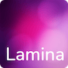

I'm a full-stack software engineer based in Manchester, UK.

🖼️ [Sometimes I help people code](./women-tech-makers.jpg).
 
👨‍💻 I write on [Substack](https://wildercode.substack.com).
 
 Feel free to check out my [LinkedIn](https://www.linkedin.com/in/duncanwilder/).

### What I've worked on

|                                                                                                          |                                                                                                                                                                                        |
| -------------------------------------------------------------------------------------------------------- | -------------------------------------------------------------------------------------------------------------------------------------------------------------------------------------- |
|          | **[Gooder News](https://goodernews.duncanwilder.com)** An AI-powered news aggregator that filters positive news stories.                                                          |
|            | **Saltplate** A recipe management website with smart shopping list features.                                                                                                      |
|                  | **Rwist** A Rust utility to manage website infrastructure and deploy sites with ease.                                                                                             |
|             | **[Highdash](https://github.com/DuncanWilder/highdash)** A lightweight replacement for Lodash.                                                                                    |
|               | **Lamina** A dependency inversion layer for component testing. Write your code once, then use any component testing framework you want.                                      |
|             | **[Testflex](https://github.com/DuncanWilder/testflex)** A dependency inversion layer for your unit test code. Write your test code once, then use any test runner you want. |
|  | **[BooleanSearchParser](https://github.com/DuncanWilder/BooleanSearchParser)** Convert boolean search queries into MySQL Fulltext Search format.                                  |
